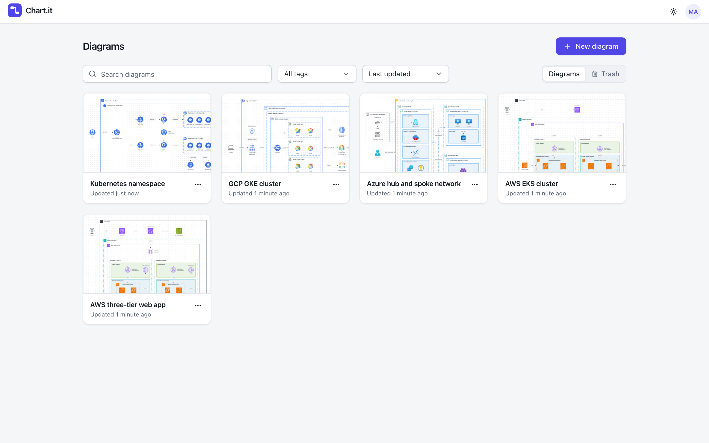
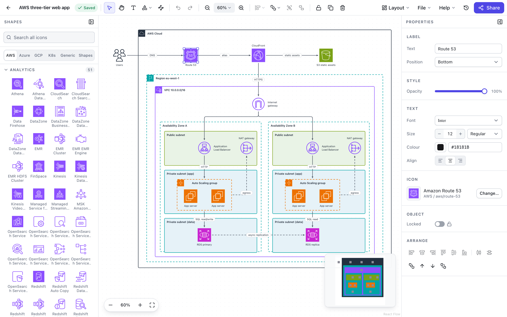
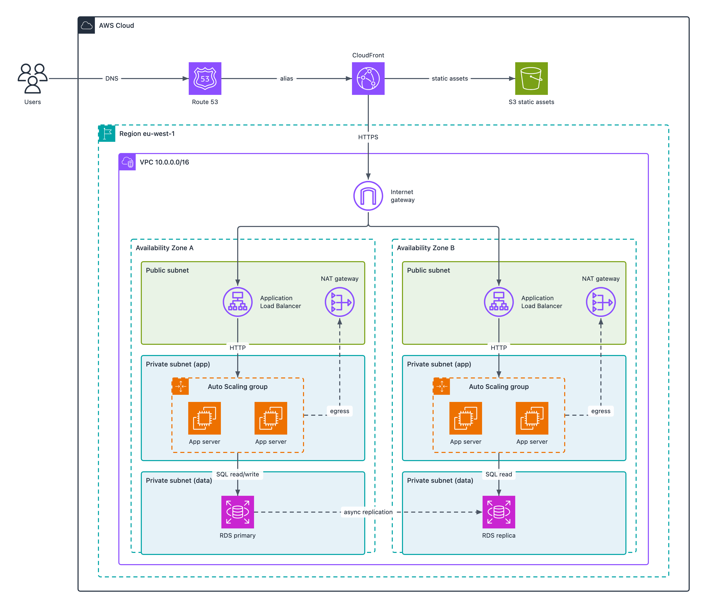

# Chart.it

Chart.it is a self-hosted architecture diagramming tool for AWS, Azure, GCP and Kubernetes. It is a best-effort Lucidchart clone: a drag-and-drop canvas with the official vendor icon sets, nested containers (VPCs, subnets, resource groups, namespaces), connectors that route around shapes, version history, read-only share links and export to PNG, SVG, PDF and JSON.

It ships as a single Go binary that serves a JSON API and an embedded React single-page app. Everything is stored in one SQLite file, and sign-in goes through OpenID Connect (any compliant provider, for example Cognito, Authentik or Keycloak).

```
browser  ->  chartit (Go binary)  ->  SQLite file on a volume
              |- /api/v1   JSON API
              |- /auth     OIDC code flow with PKCE (or test login)
              '- /         embedded React SPA
```

## Screenshots

| | |
|---|---|
|  |  |
| Dashboard with templates, search, tags and trash | Editor with the shape library, canvas and properties panel |



The three files expected in `docs/images/` are `dashboard.png`, `editor.png` and `export-aws.png`.

## Features

Editor

- Canvas built on React Flow with four node types: icon, container, shape and text. Nine shapes (rectangle, rounded rectangle, ellipse, diamond, cylinder, hexagon, parallelogram, cloud, note).
- 22 container kinds with provider styling and badge icons: `aws.cloud`, `aws.region`, `aws.account`, `aws.vpc`, `aws.availabilityZone`, `aws.subnet.public`, `aws.subnet.private`, `aws.securityGroup`, `aws.autoScaling`, `azure.subscription`, `azure.resourceGroup`, `azure.vnet`, `azure.subnet`, `gcp.project`, `gcp.vpc`, `gcp.region`, `gcp.zone`, `k8s.cluster`, `k8s.namespace`, `k8s.node`, `k8s.pod` and `generic`. Containers nest, and dropping a node on a container parents it.
- Connectors: orthogonal, straight or bezier, with five marker kinds at each end (none, arrow, open arrow, diamond, circle), labels, and per-edge waypoints. "Reroute edges" runs an obstacle-avoiding grid router over orthogonal edges.
- Automatic layout through ELK (layered and orthogonal algorithms, top-to-bottom or left-to-right, whole diagram or the selected nodes), plus "Tidy edges" and "Reset edge routes" in the Layout menu.
- Icon library with search across the AWS, Azure, Google Cloud, Kubernetes and generic packs (about 1,700 icons), an icon picker, and recently used icons.
- Properties panel for fill, stroke, opacity, radius, fonts, label position, edge style and document settings (background, grid dots/lines/none, snap to grid, grid size, theme).
- Group and ungroup, z-order, lock, align and distribute, nudge, duplicate, copy and paste (the clipboard payload is also written as text, so it pastes between diagrams), undo and redo (100 steps), and a command palette.
- Light, dark and system themes.

Documents

- Dashboard with five starter templates (AWS three-tier, AWS EKS, Azure hub and spoke, GCP GKE, Kubernetes namespace), search, tag filter, sort, rename, duplicate, soft delete and restore from trash, and thumbnails.
- Autosave with optimistic concurrency. A save carrying a stale version is rejected with 409 and the editor offers Reload or Overwrite.
- Version history: automatic snapshots at most every five minutes, named versions, preview and restore. At most 200 snapshots are kept per diagram.
- Read-only share links (`/s/<token>`) that can be revoked.
- Import and export of the JSON document format.

Platform

- One static binary, embedded SPA, embedded starter templates, goose migrations applied at startup.
- Single-user mode (`CHARTIT_SINGLE_USER=1`) for running one container on your own machine with no sign-in.
- OIDC authorisation code flow with PKCE, state and nonce. A test login mode for local development (`CHARTIT_ALLOW_TEST_AUTH=1`) that the binary refuses to combine with OIDC settings.
- Helm chart, multi-arch (amd64 and arm64) image, `/healthz` and `/readyz` probes, structured JSON logs.

## Quick start

### Single-user container

To run Chart.it on your own machine with no sign-in:

```sh
docker run -d --name chartit -p 127.0.0.1:8080:8080 -v chartit-data:/data -e CHARTIT_SINGLE_USER=1 ghcr.io/hayward-solutions/chart.it:latest
```

Open http://localhost:8080. Every request acts as one built-in user, `Local user`, and diagrams persist in the `chartit-data` volume. The account menu has no Sign out entry in this mode.

Single-user mode has no authentication: anyone who can reach the port has full access. Publish the port on `127.0.0.1` as above. The API only answers requests whose `Host` is `localhost`, `*.localhost`, `127.0.0.1`, `::1` or the host of `CHARTIT_BASE_URL`, which stops other websites reaching it through DNS rebinding. To use another address, for example a LAN name, set `CHARTIT_BASE_URL` to it; that also makes share links point at it. The binary refuses to start when `CHARTIT_SINGLE_USER=1` is combined with test auth or any `CHARTIT_OIDC_*` setting.

### Docker Compose

```sh
docker compose up --build
```

Open http://localhost:8080. `docker-compose.yml` runs in single-user mode (`CHARTIT_SINGLE_USER=1`), publishes the port on `127.0.0.1` only and stores the database in `./data`. The container runs as uid 65532, so on Linux make `./data` writable by that user before the first start.

### Local development

Requirements: Go 1.26, Node 24 and npm.

```sh
make dev
make dev-web
```

`make dev` runs the Go server on :8080 with test authentication. `make dev-web` runs the Vite dev server on http://localhost:5173, which proxies `/api` and `/auth` to :8080. Use the Vite URL while developing the frontend.

To try the production shape, run `make build` and start `bin/chartit` with `CHARTIT_ALLOW_TEST_AUTH=1`.

### Test login

With `CHARTIT_ALLOW_TEST_AUTH=1`, `/auth/login` shows a one-field form. It submits to `/auth/test-login?user=<name>`, which upserts a user with subject `test:<name>` and e-mail `<name>@test.local`, starts a session and redirects to `/`. User names must match `[A-Za-z0-9._-]{1,64}`. You can also open the URL directly:

```sh
open "http://localhost:8080/auth/test-login?user=alice"
```

## Configuration

All configuration is through environment variables. Copy `.env.example` as a starting point.

| Variable | Default | Required | Description |
|---|---|---|---|
| `CHARTIT_ADDR` | `:8080` | no | Listen address. |
| `CHARTIT_DATA_DIR` | `./data` | no | Directory holding `chartit.db`. Created if missing. The container image sets `/data`. |
| `CHARTIT_BASE_URL` | `http://localhost:8080` | set it in production | Public URL, an absolute http(s) URL. Used for the OIDC redirect (`<base>/auth/callback`) and share links. An `https` URL turns on the `Secure` cookie flag. |
| `CHARTIT_SESSION_SECRET` | none | yes, unless single-user or test auth is on | At least 32 bytes. Keys the encrypted login-flow cookie. |
| `CHARTIT_OIDC_ISSUER` | none | yes, unless single-user or test auth is on | OIDC issuer URL. Discovery runs against it on first login. |
| `CHARTIT_OIDC_CLIENT_ID` | none | yes, unless single-user or test auth is on | OIDC client id. |
| `CHARTIT_OIDC_CLIENT_SECRET` | none | no | Client secret, for confidential clients that have one. |
| `CHARTIT_OIDC_SCOPES` | `openid profile email` | no | Space-separated scopes. Must not be empty. |
| `CHARTIT_SINGLE_USER` | `0` | no | `1` or `true` turns off sign-in: every request acts as one built-in user, and the API only answers local hosts and the host of `CHARTIT_BASE_URL`. Startup fails if test auth or any `CHARTIT_OIDC_*` variable is also set. |
| `CHARTIT_ALLOW_TEST_AUTH` | `0` | no | `1` or `true` enables test login. Startup fails if any `CHARTIT_OIDC_*` variable is also set. |
| `CHARTIT_LOG_LEVEL` | `info` | no | `debug`, `info`, `warn` or `error`. |
| `CHARTIT_MAX_DOCUMENT_BYTES` | `5242880` | no | Server-side size limit for diagram content, a positive integer. |

Startup fails when none of OIDC (issuer and client id), single-user mode or test auth is configured.

Sessions last 30 days and live in the database; expired sessions are swept hourly.

## Deployment to Kubernetes

The Helm chart is published to GitHub Container Registry as an OCI artifact on every release (`vX.Y.Z` tag) and for every merge to `main`.

```sh
helm install chart-it oci://ghcr.io/hayward-solutions/charts/chart-it \
  --version 0.1.0 \
  --namespace chart-it --create-namespace \
  --values values.yaml
```

Example `values.yaml`:

```yaml
image:
  tag: v0.1.0
config:
  baseUrl: https://chart-it.example.com
  oidc:
    issuer: https://issuer.example.com
    clientId: chart-it
existingSecret: chart-it-secrets
persistence:
  enabled: true
  storageClass: ""
  size: 2Gi
ingress:
  enabled: true
  className: nginx
  hosts:
    - host: chart-it.example.com
      paths:
        - path: /
          pathType: Prefix
  tls:
    - secretName: chart-it-tls
      hosts:
        - chart-it.example.com
```

Requirements:

- Secret. `existingSecret` names a Secret that is loaded with `envFrom`. It must contain `CHARTIT_SESSION_SECRET` (32 or more bytes) and `CHARTIT_OIDC_CLIENT_SECRET`:

  ```sh
  kubectl --namespace chart-it create secret generic chart-it-secrets \
    --from-literal=CHARTIT_SESSION_SECRET="$(openssl rand -hex 24)" \
    --from-literal=CHARTIT_OIDC_CLIENT_SECRET="<client secret>"
  ```

- Volume. With `persistence.enabled: true` (the default) the chart creates a PersistentVolumeClaim (`ReadWriteOnce`, empty `storageClass`, which selects the cluster default, and default size `2Gi`) mounted at `/data`. Use `persistence.existingClaim` to bring your own. With persistence off the database lives in an `emptyDir` and is lost on every restart.
- One replica. SQLite allows a single writer, so the Deployment is fixed at one replica with the `Recreate` strategy. Upgrades have a short outage.
- Base URL. Set `config.baseUrl` to the public URL, and register `<baseUrl>/auth/callback` as an allowed callback with the identity provider.
- Hardening. The pod runs as uid 65532 with a read-only root filesystem, all capabilities dropped and no service account token mounted.
- Probes. `/healthz` for startup and liveness, `/readyz` (checks the database) for readiness.
- Image. `ghcr.io/hayward-solutions/chart.it`. If the package is private, add `imagePullSecrets`.

Any extra environment variable can be added through the chart's `env` map.

### Ingress

Any ingress class works. Set `ingress.className` to the class your cluster provides (or leave it empty to use the cluster default) and add whatever annotations your controller needs. `CHARTIT_BASE_URL` (`config.baseUrl`) must match the public URL users reach, including the scheme, because it is used for the OIDC redirect and for share links.

## Icon packs and licensing

Icons live in `web/public/icons/` together with `manifest.json`. They are generated by `tools/icons`, never edited by hand, and each pack carries its licence string in the manifest.

| Pack | Source | Terms |
|---|---|---|
| AWS | AWS Architecture Icons package | AWS Architecture Icons terms and trademark guidelines |
| Azure | Microsoft Azure public service icons | Microsoft terms of use for Azure icons |
| Google Cloud | Google Cloud core product and legacy icons | Google Cloud icon terms |
| Kubernetes | `kubernetes/community` icons | CC BY 4.0 |
| Generic | Authored for Chart.it | MIT (project licence) |

The icons remain the property of their owners and are redistributed unmodified apart from technical normalisation. See [ATTRIBUTION.md](ATTRIBUTION.md) for sources, terms and trademark notices.

To regenerate the packs and the manifest (downloads the vendor archives, normalises the SVGs, and verifies the result):

```sh
make icons
```

`tools/icons/README.md` documents the individual `fetch`, `build` and `verify` commands, the normalisation and rejection rules, and how to add an icon.

## Keyboard shortcuts

Shortcuts work while the canvas has focus. `Mod` is Cmd on macOS and Ctrl elsewhere. Press `?` in the editor to see the list.

| Action | Shortcut |
|---|---|
| Select tool | `V` |
| Pan tool | `H` |
| Pan while held | `Space` |
| Text tool | `T` |
| Rectangle tool | `R` |
| Ellipse tool | `O` |
| Diamond tool | `D` |
| Connector tool | `L` |
| Cancel, or deselect | `Esc` |
| Undo | `Mod+Z` |
| Redo | `Mod+Shift+Z`, `Mod+Y` |
| Cut, copy, paste | `Mod+X`, `Mod+C`, `Mod+V` |
| Duplicate | `Mod+D` |
| Delete | `Delete`, `Backspace` |
| Select all | `Mod+A` |
| Edit label | `Enter`, `F2` |
| Group | `Mod+G` |
| Ungroup | `Mod+Shift+G` |
| Bring forward, send backward | `Mod+]`, `Mod+[` |
| Bring to front, send to back | `Mod+Shift+]`, `Mod+Shift+[` |
| Lock or unlock | `Mod+L` |
| Nudge by 1 | Arrow keys |
| Nudge by 10 | `Shift+Arrow` |
| Zoom in | `Mod+=` |
| Zoom out | `Mod+-` |
| Fit to screen | `Mod+0` |
| Zoom to 100% | `Mod+1` |
| Command palette | `Mod+K` |
| Keyboard shortcuts | `?` |

Align, distribute, reroute edges, grid and snap toggles, and the insert commands for every shape and container kind have no shortcut but are in the command palette.

## Export formats

File > Export opens the export dialog. Exports are rendered from the document model, not from a screenshot of the canvas.

| Format | Notes |
|---|---|
| PNG | 1x, 2x or 4x. Large diagrams are scaled down to stay under 16384 px on a side and 100 megapixels. |
| SVG | Standalone, with icons inlined. |
| PDF | One page sized to the diagram (capped at 14400 pt on the longest side), containing a rasterised render. |
| JSON | The schema v1 document. File > Import JSON loads it back. |

Options: transparent background, selection only, file name. File > Copy as PNG puts the selection (or the whole diagram) on the clipboard.

## Development

Layout:

```
cmd/chartit/      entrypoint
internal/         config, db, store, auth, api, ui, server, problem, ids
templates/        starter diagrams (schema v1 JSON), embedded
web/              Vite + React 19 + TypeScript SPA
tools/icons/      icon pack pipeline (separate Go module)
charts/chart-it/  Helm chart and golden render tests
e2e/              Playwright suite
```

[AGENTS.md](AGENTS.md) is the source of truth for conventions, the HTTP API and the document schema. [docs/architecture.md](docs/architecture.md) explains how the pieces fit, and decision records are in `docs/adr/`.

Make targets:

| Target | What it does |
|---|---|
| `make dev` | Run the Go server with test auth on :8080 |
| `make dev-web` | Run the Vite dev server on :5173 proxying `/api` and `/auth` to :8080 |
| `make test` | Go unit tests |
| `make test-web` | Web unit tests (Vitest) |
| `make test-e2e` | Build, then run Playwright against the built binary |
| `make lint` | `lint-go` and `lint-web` |
| `make lint-go` | `gofmt` check and golangci-lint |
| `make lint-web` | ESLint and TypeScript typecheck |
| `make build-web` | Build `web/dist` and copy it to `internal/ui/dist` for embedding |
| `make build` | `build-web`, then the Go binary into `bin/chartit` |
| `make icons` | Regenerate `web/public/icons` |
| `make docker` | Build the container image (`IMAGE`, default `chart.it:dev`) |
| `make tidy` | `go mod tidy` |
| `make clean` | Remove `bin/` |
| `make help` | List targets |

Notes:

- Go lint uses golangci-lint v2 with the baseline in `.golangci.yml`; CI also runs `go vet` and `govulncheck`. `make test` covers `./cmd/...`, `./internal/...` and `./templates/...`. The icon tool is its own module: `cd tools/icons && go vet ./... && go test ./...`.
- Web tests use Vitest and Testing Library with MSW for API mocks. `make lint-web` runs `npm run lint` and `npm run typecheck`.
- `make test-e2e` builds the binary and then runs `npm test` inside `e2e/`. Run `cd e2e && npm ci && npx playwright install chromium` once first. CI installs these itself.
- Helm: `helm lint charts/chart-it --strict` and `charts/chart-it/scripts/helm-golden.sh --check` (run it without `--check` to rewrite the golden files after a template change).
- Git hooks come from [lefthook](https://github.com/evilmartians/lefthook). Run `lefthook install` once. The pre-commit hook runs Prettier and ESLint on staged web files and `gofmt`, `go vet` and `golangci-lint --fast-only` on Go files.
- `make dev` embeds whatever is in `internal/ui/dist` at compile time. Run `make build-web` to populate it, or use `make dev-web` for frontend work. Without a built frontend the server returns a placeholder page.

## Releasing

Pull requests run the path-filtered checks in `.github/workflows/pull-request.yaml` (Go, icon tool, web, Helm, Docker build, end-to-end) and a final `CI result` job. Merges to `main` (`merge.yaml`) publish `ghcr.io/hayward-solutions/chart.it:main`, a Trivy scan, and a `0.0.0-main+<sha>` chart.

To release, tag the commit and push the tag:

```sh
git tag v0.1.0
git push origin v0.1.0
```

`release.yaml` runs on any `v*` tag. It builds the image on native amd64 and arm64 runners, publishes the multi-arch manifests `ghcr.io/hayward-solutions/chart.it:vX.Y.Z` and `:latest`, scans the image with Trivy (fixable CRITICAL findings fail the run), publishes the chart to `oci://ghcr.io/hayward-solutions/charts` with `version` set to the tag without the `v` and `appVersion` set to the tag, and creates a GitHub release with generated notes. A tag containing `-` (for example `v0.2.0-rc.1`) is marked as a pre-release.

Move the `Unreleased` entries in [CHANGELOG.md](CHANGELOG.md) under the new version before tagging.

## Licence

Chart.it is released under the MIT licence; see [LICENSE](LICENSE). The vendor icon packs keep their own terms, listed above and in [ATTRIBUTION.md](ATTRIBUTION.md).
